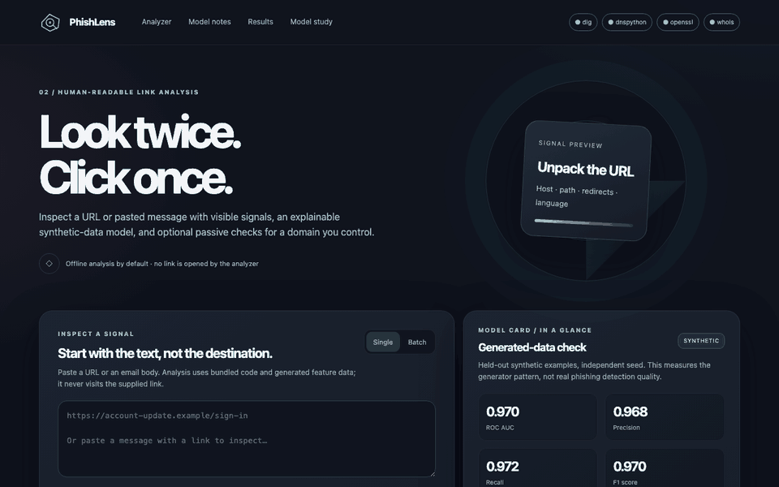
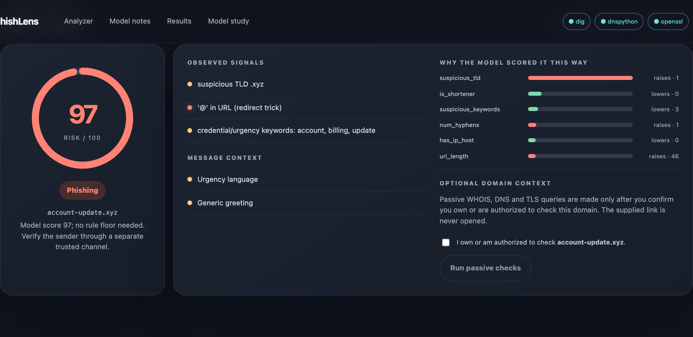
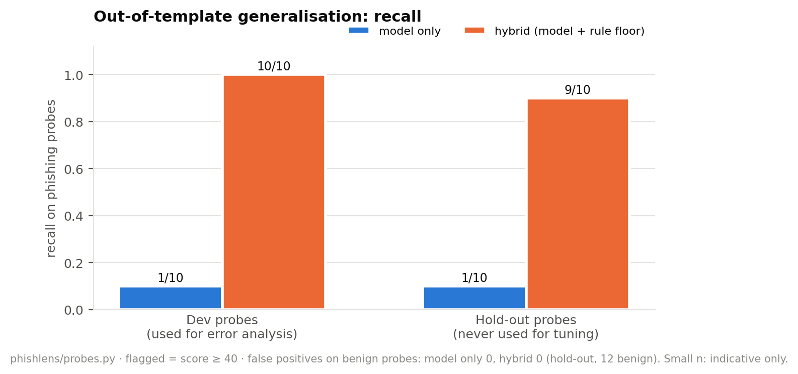
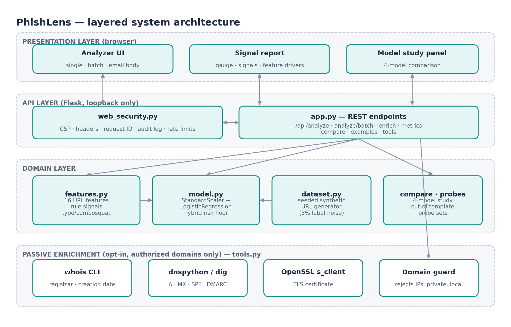

# PhishLens



The walkthrough scores an inert sample URL locally and never opens it; public-data results are reported separately below.

**Explainable hybrid phishing-URL detection, with an honest out-of-template evaluation.**

Design Project II · Semester IV (2024–25) · B.Tech, specialisation in Cyber Security, DISC, Hindustan Institute of Technology and Science, Chennai · by **Malepati Sree Harsha**

 [](https://codecov.io/gh/harshacreate/PhishLens)    



PhishLens scores a URL, a pasted e-mail or a batch of links, and shows exactly which signals and features drove the score. It never opens the links it analyses. On a small hand-written probe set, the model alone caught 1 in 10 phishing URLs; a transparent hybrid caught 9 in 10. The real-data evaluation below is separate and reports lower recall on public URLs.

## Real-data results

Held-out evaluation on 33,142 phishing domains from PhiLegit-100K v1 and 33,142 benign-domain proxies from Tranco list 947N2. One URL per Public-Suffix-List registrable domain; overlapping domains removed; 66,284 URLs total. The model remained trained on synthetic data only. No URL was visited. Both scorers use the existing threshold of 70.

| Scorer | Precision (95% CI) | Recall (95% CI) | F1 (95% CI) |
|---|---|---|---|
| Model only | **0.986** (0.984–0.988) | **0.401** (0.396–0.407) | **0.570** (0.565–0.576) |
| Hybrid | **0.982** (0.980–0.984) | **0.416** (0.411–0.421) | **0.584** (0.579–0.590) |

This is a balanced case-control set, so precision is not an estimate of deployment positive predictive value. The hybrid raises recall slightly and also produces more false alerts against the Tranco benign proxy. Dataset provenance, license, split, exclusions, checksums, limitations, and the exact reproduction command are in [Real-data evaluation](docs/REAL_DATA.md).

## Synthetic and probe results (measured)

| Result | Value |
|---|---|
| In-distribution F1, four models (synthetic, 2,400 URLs) | **0.962 – 0.970** (tie at the 3% label-noise ceiling) |
| Hand-written probe recall, **model only** | **1 / 10** (shortcut learning) |
| Hand-written probe recall, **hybrid** (typosquat + combosquat signals, risk floor) | **9 / 10**, false positives **0 / 12** |
| Security fix | SSRF in TLS enrichment found and fixed (resolve once, refuse non-global IPs, connect to the vetted IP) |
| Automated tests | **20 / 20 passing** |
| Single-URL analysis under load | p50 5.3 ms · 1,391 req/s; `/api/metrics` cut from 240 ms to 3.8 ms by caching |

| Model | F1 | ROC-AUC | 5-fold AUC |
|---|---|---|---|
| Logistic Regression | 0.970 | 0.968 | 0.970 ± 0.007 |
| Decision Tree | 0.968 | 0.966 | 0.963 ± 0.011 |
| Random Forest | 0.962 | 0.965 | 0.973 ± 0.007 |
| Gaussian Naive Bayes | 0.970 | 0.969 | 0.970 ± 0.005 |



The hand-written probe set (10 phishing, 12 benign) was written before the hybrid was designed and never used for tuning. Its 95% Wilson interval for hybrid recall is 0.596–0.982; for 0/12 false positives, the false-positive-rate interval is 0–0.242. These illustrative probes are small. The public-source results above use a separate domain-disjoint evaluation.

## Features

- **16 interpretable URL features** and human-readable rule signals (IP host, punycode, `@` trick, suspicious TLD, shortener, redirect, brand look-alike, keywords …).
- **Exact explanations:** logistic regression; each feature's contribution = coefficient × standardised value.
- **Typosquat and combosquat detection** (`paypa1`, `linkedln`, `hdfc-netbanking-kyc-update`).
- **Hybrid scoring:** a high-severity signal sets a risk floor of 75; the model's own score is always shown alongside.
- **E-mail cues:** urgency, credential/payment requests, generic greetings.
- **Batch mode** (≤ 25 URLs), JSON export, print view.
- **Model study:** logistic regression vs decision tree vs random forest vs naive Bayes, confusion matrices, 5-fold CV.
- **Opt-in passive enrichment:** WHOIS, A/MX/SPF/DMARC and TLS certificate, only for domains you confirm you are authorized to check.

## Architecture



## Quick start

Run the published image:

```bash
docker run --rm -p 127.0.0.1:8102:8000 ghcr.io/harshacreate/phishlens:latest
```

```bash
docker compose up --build -d
open http://localhost:8102
```

```bash
python3 -m venv .venv && source .venv/bin/activate
python -m pip install -r requirements.txt
make test       # 20 tests
make evaluate   # held-out metrics
make compare    # four-model study
make probes     # out-of-template evaluation (dev + hold-out)
make run        # http://127.0.0.1:8000
```

## Security

The analysed URL is never fetched. Enrichment requires an explicit authorization flag, accepts only public DNS names, and refuses names that resolve to loopback, private or metadata addresses (SSRF). It also has an audit log and a rate limit. Strict CSP, OWASP headers, no-store API responses and body-free logs apply throughout. See [SECURITY.md](SECURITY.md).

## Documentation

| Document | |
|---|---|
| [Project report (PDF)](report/PhishLens_Project_Report.pdf) · [Word](report/PhishLens_Project_Report.docx) | IEEE-style report: literature survey, SRS, UML/DFD, implementation, testing, results, references |
| [Presentation (PowerPoint)](report/PhishLens_Presentation.pptx) · [PDF](report/PhishLens_Presentation.pdf) | Review / viva slides with speaker notes |
| [Synopsis](report/PhishLens_Synopsis.pdf) | Two-page project synopsis |
| [Demo script](report/Demo_Script.md) | Timed live-demonstration walkthrough |
| [Viva questions](report/Viva_Questions.md) | Likely examiner / interviewer questions with answers |
| [Portfolio copy](report/Portfolio_Copy.md) | GitHub description, LinkedIn and resume text |
| [Real-data evaluation](docs/REAL_DATA.md) | Pinned public sources, license and split details, confidence intervals, and reproduction command |
| [Showcase page](docs/index.html) | Landing page for GitHub Pages (Settings → Pages → `main` / `docs`) |
| [Security policy](SECURITY.md) · [Contributing](CONTRIBUTING.md) · [Changelog](CHANGELOG.md) | Threat model, disclosure process, workflow, history |

## Limitations and roadmap

- The model is still trained on synthetic URLs. On the held-out balanced public-source set, hybrid recall is 0.416; this is a case-control result, not deployment performance.
- Registered domains and subdomain counts use the offline Public Suffix List snapshot bundled with pinned tldextract 5.4.0. Upgrade that dependency deliberately to refresh the suffix data.
- Brandless lures on free web hosting are still missed (1 hold-out miss).
- Fixed brand list (20). Next: learn brands from certificate-transparency logs.

## Repository layout

```
├── .dockerignore
├── .env.example
├── .github/
│   └── workflows/
│       └── ci.yml
├── .gitignore
├── CHANGELOG.md
├── CONTRIBUTING.md
├── Dockerfile
├── LICENSE
├── Makefile
├── PROJECT_OVERVIEW.md
├── README.md
├── SECURITY.md
├── Start.command
├── docker-compose.yml
├── docs/
│   ├── README.md
│   ├── diagrams/  (12 images)
│   ├── REAL_DATA.md
│   ├── index.html
│   └── screenshots/  (7 images)
├── phishlens/
│   ├── __init__.py
│   ├── app.py
│   ├── compare.py
│   ├── data/
│   ├── dataset.py
│   ├── evaluate.py
│   ├── features.py
│   ├── model.py
│   ├── probes.py
│   ├── real_data.py
│   ├── static/
│   │   └── index.html
│   ├── tools.py
│   └── web_security.py
├── requirements.txt
├── requirements-real-data.txt
├── scripts/
│   └── loadtest.py
└── tests/
    ├── test_phishlens.py
    └── test_security.py
```

## License

MIT, see [LICENSE](LICENSE).
