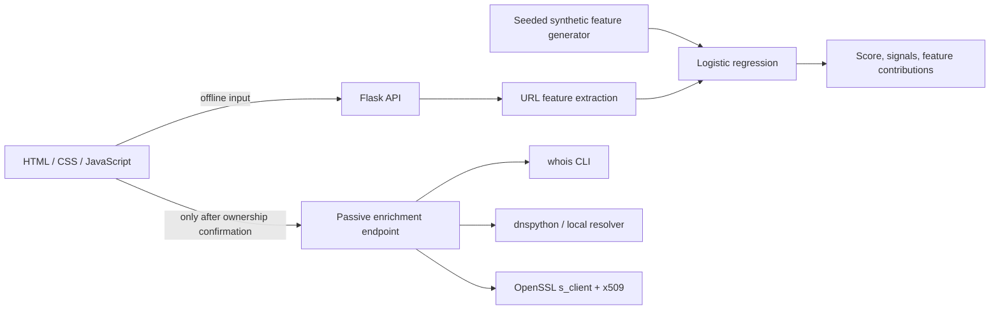

# PhishLens

**Read the signal in a link before a person clicks it.**


PhishLens parses one URL, a pasted email, or a small batch; surfaces rule signals and feature contributions; then assigns a score using an explainable logistic-regression model trained on generated URL features. It runs offline by default. Optional WHOIS, DNS, and TLS checks require an explicit confirmation that the user owns or is authorized to check the selected public domain.

## Problem / why it matters

Security awareness tools can output a single “safe” or “dangerous” label without showing their reasoning. PhishLens exposes the URL traits and model features that influenced its score, making it possible to challenge the decision instead of treating it as proof.

## What I built

- URL and email-body extraction, with checks for IP hosts, punycode, `@` tricks, lookalike brand strings, suspicious TLDs, redirects, URL shorteners, and credential/urgency language.
- A seeded synthetic feature-data generator and a standardized logistic-regression classifier. The same feature extractor is used for training and scoring.
- Single and batch analysis, a risk gauge, visible signal list, feature-driver chart, held-out metrics, printable report, and JSON export.
- Optional passive domain enrichment with `whois`, `dig` availability reporting, `dnspython` records (A/MX/SPF/DMARC), and the OpenSSL command for TLS certificate details.
- A clear opt-in checkbox and backend authorization flag; private IPs, IP literals, and local hostnames are rejected for enrichment.

### Architecture



## Tools used

| Tool | Use |
|---|---|
| Python / Flask | Local analyzer API |
| scikit-learn | Interpretable logistic-regression model |
| `whois` | Optional registration date and registrar lookup |
| `dig` / dnspython | DNS and email-policy records; queries run only on opt-in |
| OpenSSL | Optional TLS handshake and certificate metadata |

The enrichment path is passive. It does not crawl, submit forms to, or attack a supplied site. The link text itself is never opened by PhishLens.

## Run it

### Docker

```bash
docker compose up --build -d
open http://localhost:8102
docker compose down
```

The published app port is loopback-bound. On macOS, double-click `Start.command` to start Docker, wait for health, and open the analyzer.

### Local Python

```bash
python3 -m venv .venv
source .venv/bin/activate
python -m pip install -r requirements.txt
make test
make evaluate
make run
```

Open `http://127.0.0.1:8000`. `make evaluate` prints held-out metrics from a fixed, independent generator seed.

## Results / evaluation

The model card in the UI and `make evaluate` report ROC-AUC, precision, recall, and F1 on generated feature examples. These are **synthetic-only** results. They measure separation between patterns in this generator, not accuracy on real phishing mail, new campaigns, browser telemetry, or a production corpus. Batch results are capped at 25 entries.

## What I learned / design decisions

- A model should explain its score in feature terms, even when the model itself is simple.
- Fixed seeds are not enough if a generator iterates over unordered sets; the dataset now sorts categorical choices before sampling.
- Synthetic evaluation can still reward generator shortcuts. A separate public corpus and domain-aware temporal holdout would be needed before any real-world claim.
- Passive enrichment can disclose the checked domain to public infrastructure. It is therefore disabled until the user confirms authorization and is omitted from the offline path.
- A missing DNS record or certificate detail is not itself proof of a phishing attempt.

## Limitations & next steps

The feature generator is narrow and hand-authored; phishing behavior changes quickly. Domain parsing uses lightweight heuristics and may not recognize every public-suffix edge case. WHOIS responses vary by registry, while DNS results depend on the configured resolver. The risk score is a triage hint, not a verdict or a browser blocking decision. Next steps would include validation against a licensed, dated public dataset, calibration checks, richer IDN handling, and independent review of consent and data retention.

## Scope and safety

The analyzer works offline on pasted text. It does not visit links. WHOIS, DNS, and TLS requests are disabled until a user confirms ownership or authorization for that domain; only public DNS names are accepted. No URL scanning or third-party attack is performed.

## License

MIT. See [`LICENSE`](LICENSE).
