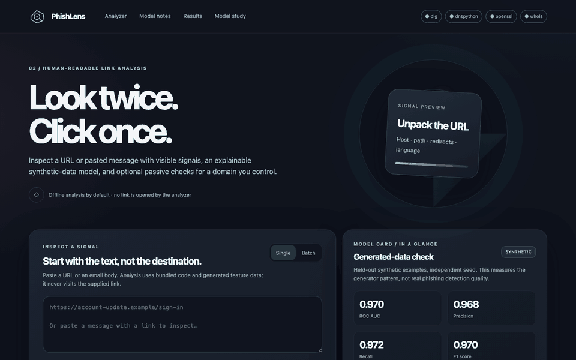
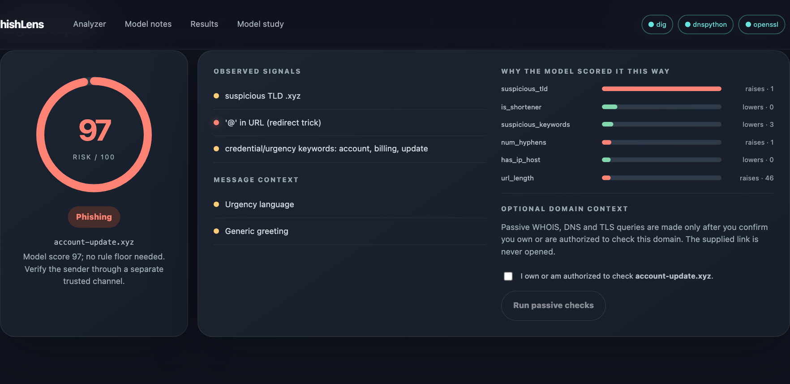

PhishLens



The walkthrough scores an inert example URL locally; the app does not open it.

PhishLens checks links and email text for signs of phishing. It explains which signs led to each score. It can also check a list of links at once. It does not open links during a normal check.

Design Project II, Semester IV (2024 to 2025), B.Tech Cyber Security, Hindustan Institute of Technology and Science. Project by Malepati Sree Harsha.

[](https://codecov.io/gh/harshacreate/PhishLens)



Results

The model was trained with links made for this project. I also checked it on a separate set of public links. That set had the same number of phishing and likely-safe links, so its precision score does not show how it will work for all users.

| Check | Result |
|---|---:|
| Model precision | 0.986 |
| Model recall | 0.401 |
| Model F1 score | 0.570 |
| Hybrid precision | 0.982 |
| Hybrid recall | 0.416 |
| Hybrid F1 score | 0.584 |

On a small hand-written test, the model alone found 1 of 10 phishing links. Extra checks for look-alike names raised this to 9 of 10, with no false alerts on 12 safe examples. This is a small test, not proof of how it will work on real links. See [Real data notes](docs/REAL_DATA.md) for test details.

What it does

- Checks parts of a link and explains the result.
- Checks email text for common warning signs.
- Checks up to 25 links at once and can save a report.
- Compares four models.
- Can look up public domain details if the user says they are allowed to check the domain.

Run it

After a version tag has been published to GHCR:

```bash
docker run --rm -p 127.0.0.1:8102:8000 ghcr.io/harshacreate/phishlens:latest
```

With Docker:

```bash
docker compose up --build -d
open http://localhost:8102
```

Without Docker:

```bash
python3 -m venv .venv
source .venv/bin/activate
python -m pip install -r requirements.txt
make test
make evaluate
make run
```

Limits and safety

The training links are made for this project, so the model may miss real phishing links. The public-link test used a balanced sample and does not show how the app will work for everyone. The app does not open links during a normal check. Optional domain checks need user approval and block local or private addresses.

See [Security notes](SECURITY.md) and the [project report](report/PhishLens_Project_Report.pdf).

The code is under the MIT license.

